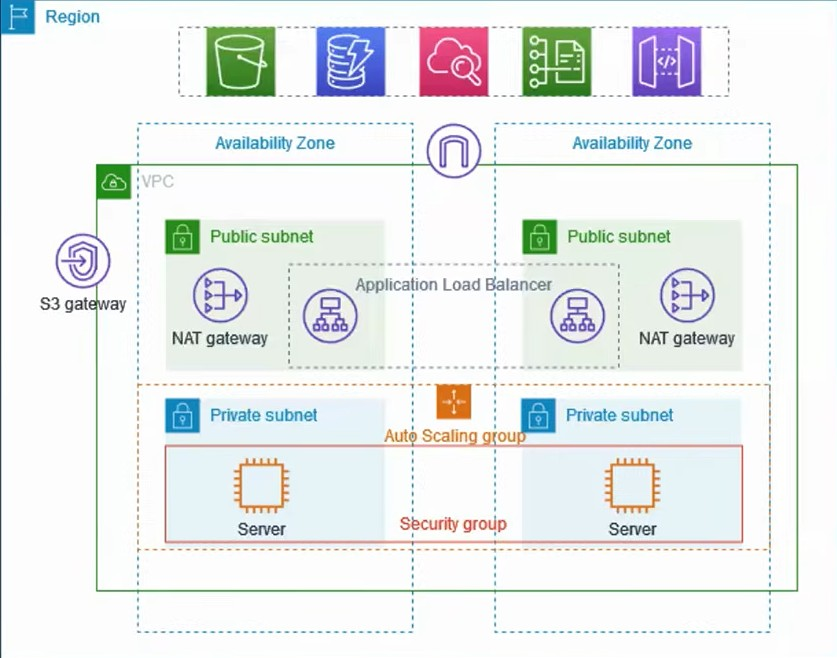

# Multi-AZ Scalable Web Architecture with Bastion Host


## Project Overview
This project provisions a production-ready, highly available AWS web architecture using Terraform. It demonstrates core DevOps and Cloud Engineering principles, including Infrastructure as Code (IaC), strict network boundaries, and automated scaling. 

The infrastructure is deployed across two Availability Zones (AZs) to ensure fault tolerance and features a strict public/private subnet topology to secure backend compute resources.

## Architecture Diagram


## Key Features & Engineering Principles
* **High Availability & Fault Tolerance:** Deployed across multiple Availability Zones with an Auto Scaling Group to seamlessly handle traffic spikes and instance failures.
* **Strict Security Boundaries:** Web servers reside in isolated private subnets with no direct internet access.
* **Controlled Access:** A Bastion Host in the public subnet serves as the single, secure SSH entry point to backend servers.
* **Secure Egress:** NAT Gateways allow private instances to securely download updates without exposing them to inbound internet traffic.
* **Cost Optimization:** An S3 Gateway VPC Endpoint routes AWS service traffic internally, bypassing the public internet to reduce data transfer costs.

## Prerequisites
* [Terraform](https://developer.hashicorp.com/terraform/downloads) (v1.0.0+)
* [AWS CLI](https://aws.amazon.com/cli/) configured with valid IAM credentials (`aws configure`)
* An AWS Account (Note: NAT Gateways incur a small hourly charge outside the Free Tier)

## Deployment Instructions

1. **Initialize Terraform**  
   Downloads the required AWS, TLS, and Local providers.
   ```bash
   terraform init
   ```

2. **Review the Deployment Plan**  
   Verifies the resources that will be created.
   ```bash
   terraform plan
   ```

3. **Apply the Infrastructure**  
   Provisions the AWS resources and generates a local SSH key pair (`bastion-app-key.pem`).
   ```bash
   terraform apply
   ```

4. **Verify Deployment**  
   * Access the web application by pasting the `alb_dns_name` output into your browser.
   * Securely SSH into the Bastion Host using the generated key:
     ```bash
     ssh -A -i bastion-app-key.pem ec2-user@<bastion_public_ip>
     ```

## Cleanup
To prevent ongoing AWS charges (specifically for the NAT Gateways), destroy all resources when finished:
```bash
terraform destroy
```

---
## Connect with Me
**JOSHUA PAR**  
*Cloud & DevOps Enthusiast*  
[Connect with me on LinkedIn](https://www.linkedin.com/in/joshuapaulopar/) | [View My Resume](https://docs.google.com/document/d/1UZJ3XZnAnbkQL6kQSuu-pFv8L7cN7g8P/edit?usp=sharing&ouid=103543603500575654268&rtpof=true&sd=true)